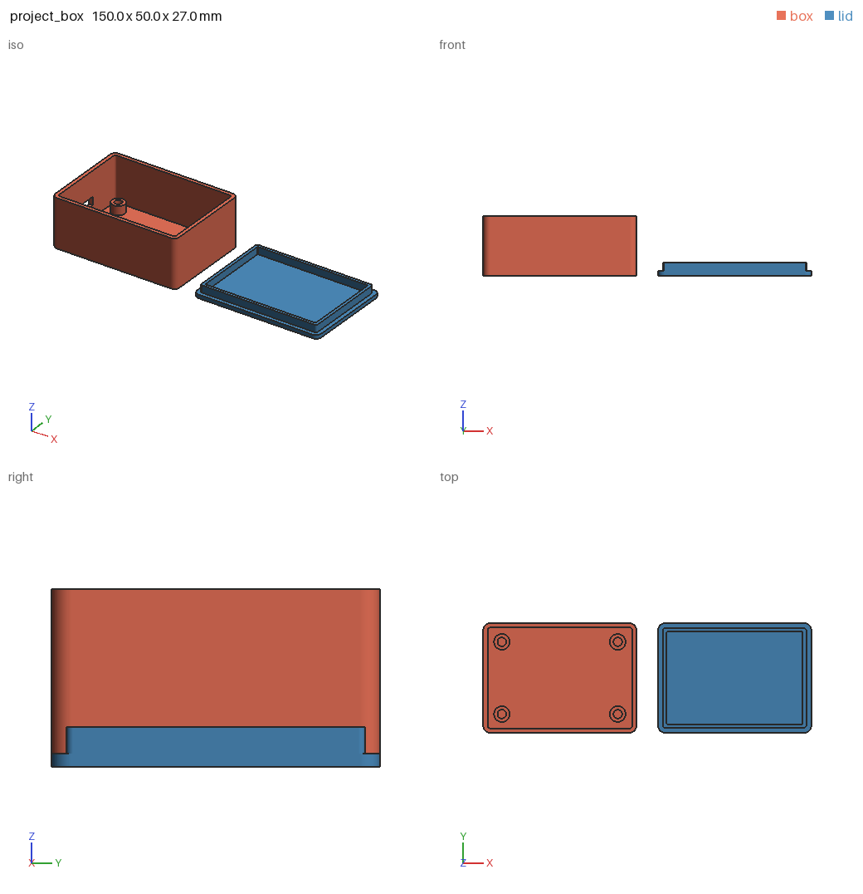
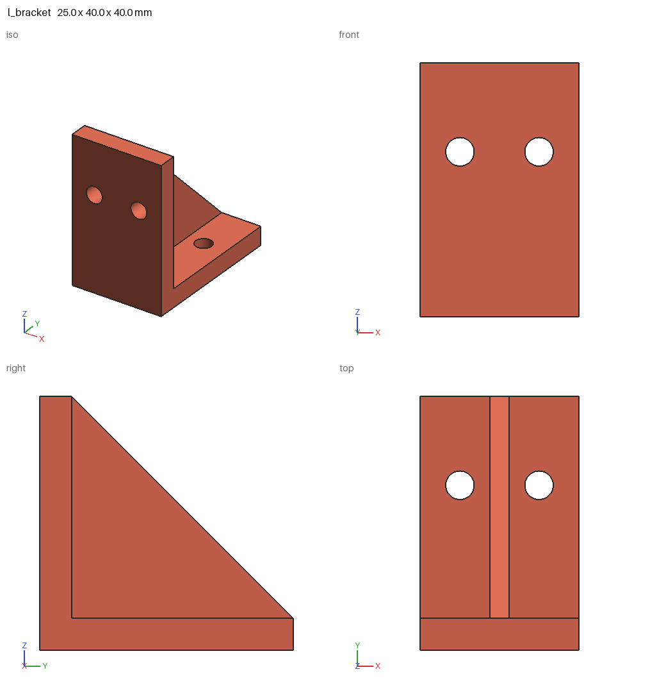
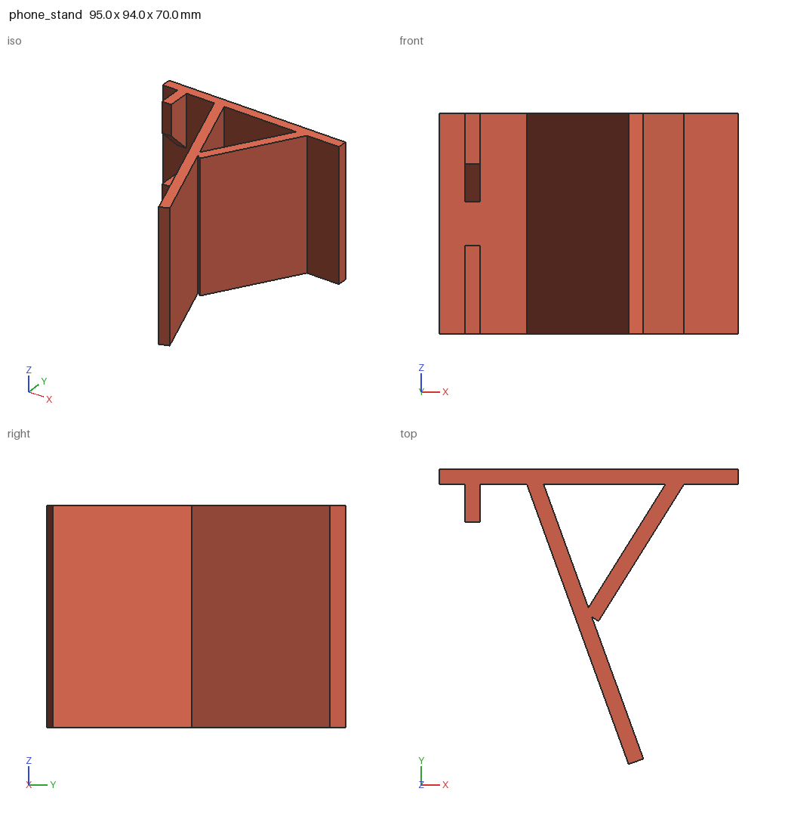
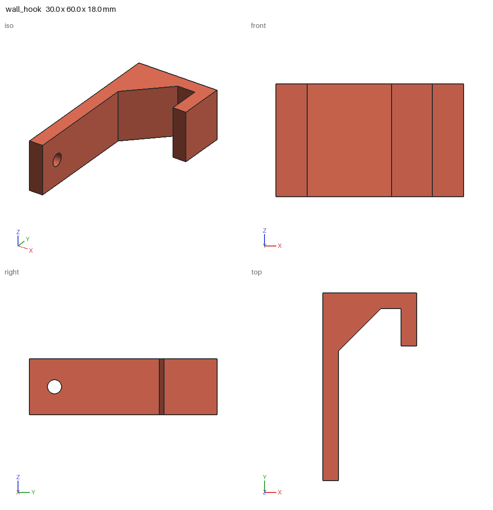
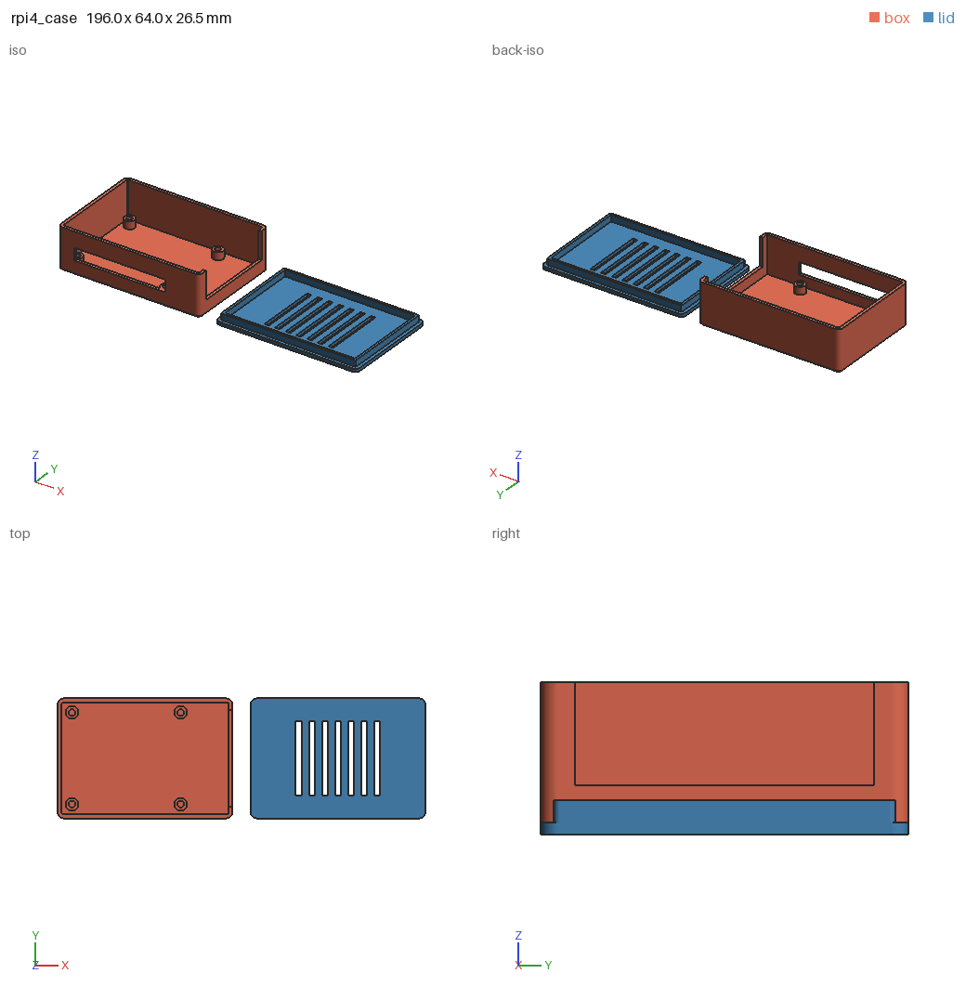

# print3d-kit

Toolkit that lets [Claude Code](https://claude.com/claude-code) design simple, **printable** 3D models,
and lets you check what it made before you waste filament.

- **Model in Python** with [build123d](https://github.com/gumyr/build123d) (OpenCascade B-rep: real fillets, chamfers, STEP).
- **One command** `p3d build model.py` → STL per part, a 3MF with all parts for your slicer, STEP for CAD, a preview PNG and a JSON report.
- **Multi-view preview** rendered headless (no GPU, no display), so the agent can *look* at its work and fix it.
- **Print checks**: watertight solid, fits the build volume, thin walls, overhangs, bed contact, tipping.
- **Parts library** with FDM-tuned tolerances: screw holes (clearance, tap, counterbore, countersunk) aimed along any axis, teardrop horizontal holes, nut traps, heat-set insert holes, standoffs, box with friction-fit lid, wall cutouts, L-bracket, wall hook.
- **Claude Code skill** with the workflow and FDM design rules baked in.

| | |
|---|---|
|  |  |
|  |  |
|  | |

## Quick start

```bash
git clone https://github.com/skurzynowski/print3d-kit && cd print3d-kit
bin/p3d build examples/project_box.py      # first run creates .venv and installs deps (~1 min)
```

Output lands in `examples/out/project_box/`:

```
== project_box on bambu-a1 (256, 256, 256): OK

[box] 70.0 x 50.0 x 27.0 mm, 18.9 cm3, ~23.4 g PLA if solid
  wall_min_mm=1.6, wall_p5_mm=2.0, overhang_area_mm2=20.0, bed_contact_mm2=3492.3
  info  overhangs: 20 mm2 of downward faces steeper than 45 deg ... (the USB-C cutout bridge)

[lid] 70.0 x 50.0 x 6.0 mm, 8.4 cm3, ~10.4 g PLA if solid
  no issues found
```

### Use it from Claude Code

Link the skill and the CLI once:

```bash
ln -s "$PWD/skills/print3d" ~/.claude/skills/print3d
ln -s "$PWD/bin/p3d" ~/.local/bin/p3d
```

Then just ask: *"Design an enclosure for a 50 x 70 mm PCB with M3 inserts and a USB-C cutout, for a Bambu A1."*
Claude writes `models/<name>.py`, builds it, reads the preview, fixes warnings and hands you the 3MF.

## Writing a model

A model is a Python file that defines `result` (one shape) or `parts` (dict of name → shape):

```python
from build123d import *
from print3d_kit import on_bed
from print3d_kit.parts import countersunk_hole

PRINTER = "prusa-mk4"          # optional default, -p on the CLI wins
W, D, T = 60, 25, 4

plate = Box(W, D, T, align=(Align.CENTER, Align.CENTER, Align.MIN))
for x in (-20, 20):
    plate -= Pos(x, 0, T) * countersunk_hole("M4", depth=T)

result = on_bed(chamfer(plate.edges().group_by(Axis.Z)[0], 0.6))
```

Hole cutters open at the origin and go into the part along `axis` (default `-Z`):
`Pos(x, y, top_z) * clearance_hole("M3", depth=5)`, or `Pos(x_max, y, z) * clearance_hole("M3", depth=5, axis="-X", teardrop=True)` for a side hole that prints without support.

## CLI

```
p3d build MODEL.py [-p PRINTER] [-o OUT] [--views iso,front,right,top] [-f stl,3mf,step]
p3d check MESH.stl|.3mf [-p PRINTER] [--min-wall 1.2] [--json]
p3d render MESH.stl [--views iso,back-iso,bottom]
p3d parts        # library catalog with signatures
p3d printers     # presets: bambu-a1, bambu-a1-mini, prusa-mk4, prusa-mini, ender3, ... or WxDxH
```

Exit codes: `0` ok, `1` a check reported an error, `2` the model script failed.

## Checks

| check | level | meaning |
|---|---|---|
| `watertight`, `winding`, `volume` | error | not a valid closed solid |
| `bed` | error | larger than the printer's build volume (tells you if rotating 90° fits) |
| `bodies` | warning | several disconnected pieces in one part |
| `thin_walls` | warning | ray-cast wall thickness below 2 × nozzle on > 1 % of the surface, with the XYZ of the thinnest spot |
| `thin_spot` | info | thinnest spot under 3 × nozzle: prints, but is weak (typically a sliver between a cutout and an edge) |
| `overhangs` | warning / info | downward faces steeper than 45° from vertical, off the bed, grouped into located regions with the bridge span measured from the walls that hold it up. Warning when a bridge/cantilever spans > 10 mm or sloped overhang exceeds 50 mm² |
| `bed_contact`, `tipping` | warning | tiny first layer, or tall and narrow |

## Roadmap

- [ ] MCP server exposing `build`, `check`, `render`, `parts` (the CLI functions are already pure Python)
- [ ] Auto-orientation suggestion (least overhang / largest bed face)
- [ ] More parts: snap-fit clips, hinges, threads, cable clips, gridfinity bins, text labels
- [ ] Configurable tolerances per printer/material
- [ ] Plugin marketplace entry for one-command install

## License

MIT
